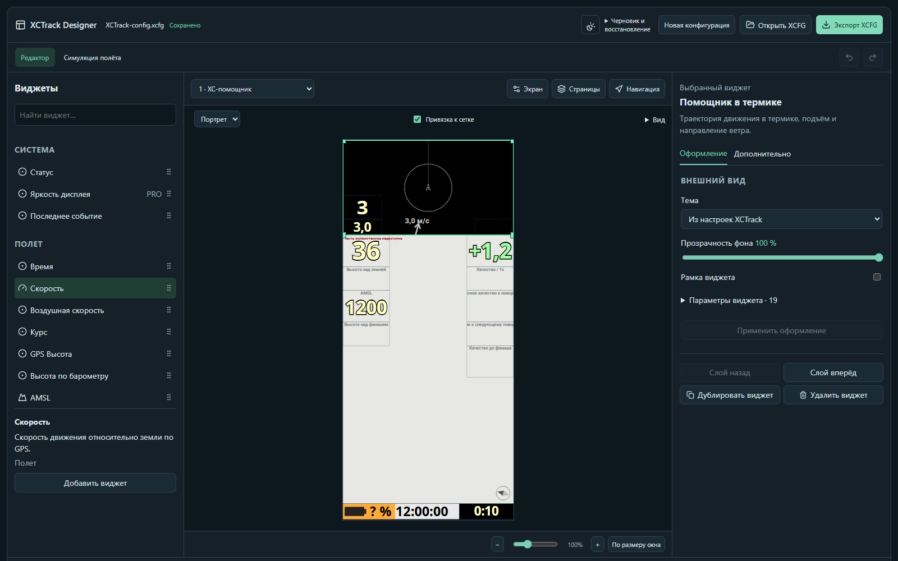
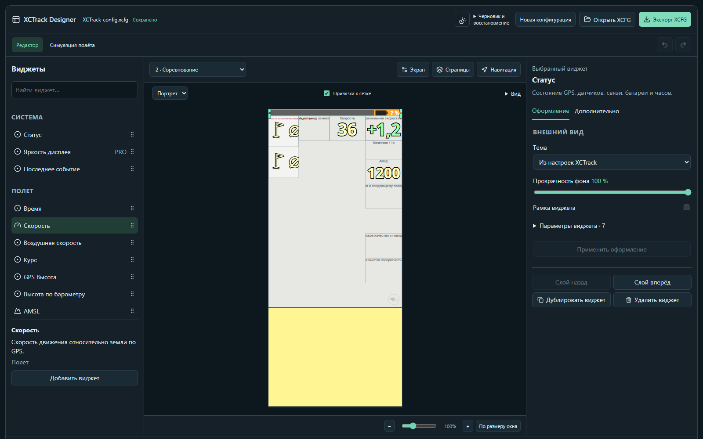
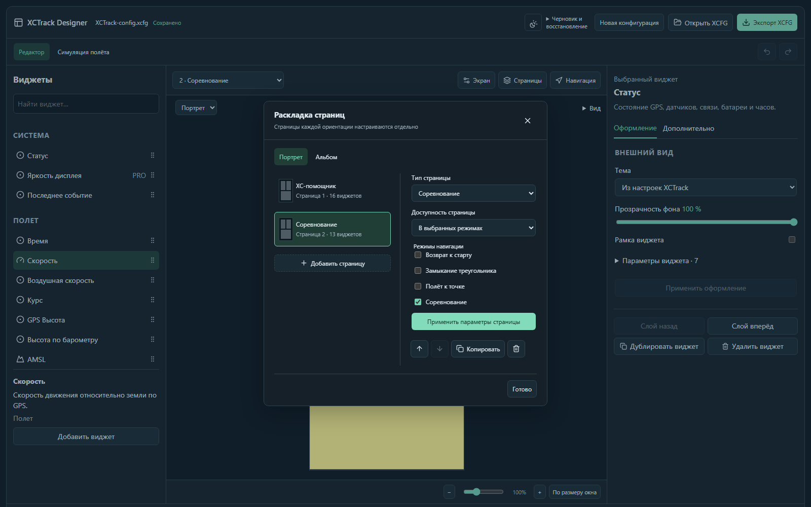
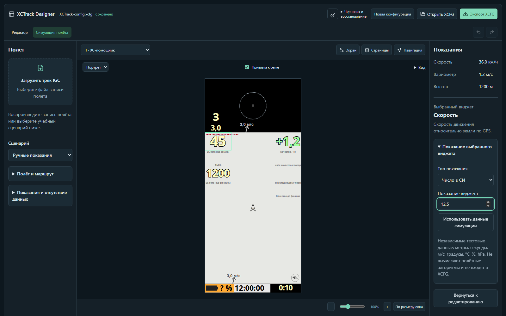

# XCTrack Screen Designer

Локальное приложение для создания и настройки экранов XCTrack. Редактор помогает собрать раскладку из виджетов, просмотреть её и проверить отображение показаний в полёте.

Основной профиль совместимости — **XCTrack 0.9.12.6 / 91260**.

## Онлайн-версия

[Открыть редактор в браузере](https://mkulkov.github.io/XCTrackDesigner/). Файлы XCFG обрабатываются в браузере и не загружаются на сайт.

## Возможности

- Импорт и экспорт файлов XCFG. Изменённая раскладка сохраняется в отдельный файл, остальные данные конфигурации остаются нетронутыми.
- Раздельные экраны для портретной и альбомной ориентации: страницы можно добавлять, копировать и настраивать.
- Каталог из 78 виджетов XCTrack с поиском. Виджеты можно размещать на экране, перемещать, менять их размер и параметры.
- Предпросмотр расположения, тем и оформления, а также отмена и повтор изменений.
- Симуляция полётных показаний, просмотр IGC-записи и отдельная настройка тестовых показаний выбранного виджета.
- Импорт навигационных точек из GEO WPT, SeeYou CUP и GPX, а задач XCTSK Classic v1 — для показа маршрута и данных навигации.
- Необязательные онлайн-карты, термики и геозоны.

Предпросмотр сложных графических виджетов и полётных расчётов может отличаться от XCTrack. Навигационные данные и симуляция используются для предпросмотра и не добавляются в экспортируемый XCFG.

## Скриншоты

Снимки редактора с примером конфигурации XCTrack: разные страницы, управление раскладкой и симуляция отдельного виджета.

<p>
  
  
</p>
<p>
  
  
</p>

## Запуск

В Windows запустите `Start-Designer.cmd`. Приложение откроется в браузере на этом компьютере.

Файлы конфигурации обрабатываются локально. При включении онлайн-карты приложение обращается к выбранным поставщикам картографических данных.

## Автоматическая сборка Windows EXE

GitHub Actions выполняет проверки кода, unit/Python и браузерные тесты, собирает переносимый EXE и проверяет упакованное приложение. После успешных проверок тег `v<версия>` создаёт GitHub Release с EXE и SHA-256. Версия тега должна совпадать с `package.json`; например, для `v0.1.1` сначала обновите версию и lockfile командой `npm version 0.1.1 --no-git-tag-version`, сохраните изменения в коммите, затем создайте и отправьте тег:

```powershell
git tag v0.1.1
git push origin v0.1.1
```

Для сборки без публикации откройте **Actions → Build Windows EXE → Run workflow**. EXE и контрольная сумма будут доступны в результате запуска **windows-exe** в течение 14 дней. Ручной запуск не создаёт релиз; существующие релизы и их файлы не перезаписываются. Сборка берёт только исходники выбранного коммита в GitHub, без незакоммиченных локальных изменений. Личные XCFG, APK и шрифты в неё не включаются. EXE пока не подписан сертификатом издателя.
