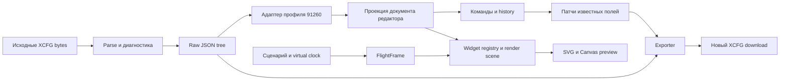

# Архитектура XCTrack Screen Designer

Статус: редактор, библиотека, связанная симуляция/IGC, графические preview, онлайн-слои и локальные черновики, 2026-10-10. Реализованы lossless token patches, структурные команды/history, inspector и SVG preview. Полный native реестр 78 классов и наблюдённые defaults отделены от render capabilities; подробности и ограничения — в [implementation.md](implementation.md), [simulation.md](simulation.md) и [widget-library.md](research/widget-library.md).
Цель: локальный конструктор с версионным воспроизведением виджетов XCTrack 0.9.12.6 и симуляцией показаний.
Доказательства: [XCFG](research/xcfg.md), [upstream](research/upstream.md), [APK](research/apk.md).

## Технологические решения

React + TypeScript, Vite для dev/build. React отвечает за панели, inspector, каталог и события; чистые TypeScript-модули — за документ, геометрию, форматирование и симуляцию.
SVG — прямоугольники, текстовые виджеты, иконки, инструменты выделения. Canvas 2D — thermal traces, насыщенная графика карты и прочие тяжёлые слои.
Единая scene description позволяет менять backend конкретного виджета без изменения документа.
Сначала проверить native text metrics и bitmap shapes; выбор SVG не гарантирует совпадение Android Paint.
Версии npm-зависимостей фиксируются lockfile на этапе создания shell, а не предполагаются по исследовательскому документу.

Dev server только `127.0.0.1`; release — статический bundle с локальным сервером. Работа с файлами через file input/drop и download Blob; File System Access API — позднее дополнительный путь с явным выбором нового файла.
Нет облачного upload, аккаунтов и аналитики. XCFG остаётся в браузере. По запросу пользователя добавлены онлайн-подложки и ограниченный loopback relay XContest в Vite dev/preview; карта передаёт поставщику запросы выбранного региона. Загруженные зоны и cache relay хранятся в RAM, офлайн-архивов нет. Optional IndexedDB сохраняет один локальный черновик исходных байтов; восстановление явное. Симуляция и карта в черновик не входят.
Исходные preferences не публикуются вместе с app bundle и не включаются в публичные fixtures.

## Поток данных

Экспорт не читает FlightFrame. Симуляция не пишет в raw tree. Preview не изменяет layout ради удобства просмотра.

## Слои и будущие каталоги

| Модуль | Ответственность |
|---|---|
| `src/config` | parse, диагностика, raw JSON, профиль 91260, patch/export |
| `src/domain` | page/widget projection, типы, immutable commands, undo/redo |
| `src/widgets` | registry по полному CLASS, metadata, inspector fields, formatter, renderer |
| `src/render` | viewport transform, clipping, композиция, theme, font metrics, SVG/Canvas bridge |
| `src/simulation` | SI frames, deterministic virtual clock, сценарии, averaging, explicit model capabilities |
| `src/ui` | page list, orientation, catalog, inspector, layers, timeline |
| `src/persistence` | optional recovery draft, schema version drafts, explicit save/reset |
| `tests` | import/export invariants, commands, unit conversions, golden screenshots |
| `docs/research` | проверенные источники и границы доказательств |

Native CLASS — строка с registry lookup, **не имя для eval или dynamic class loading**.
Imported URL/HTML/widget content не исполняется. Webpage widgets неизвестного профиля — inert placeholder.
Imported settings, sensors, auto-actions, key binding, livetracking не выполняются веб-приложением.
Limits bytes/depth/widgets и validation перед публикацией состояния UI защищают от зависания при ошибочном файле.

## Модель документа и редактирование

`SourceDocument`: original bytes, SHA256, raw tree, version info, parse diagnostics.
`EditorDocument`: ориентации и pages, widget IDs, `sourcePointer`, CLASS, bounds, ссылки на raw settings; ID вне экспортируемого дерева.
JSON types сохраняются; optional absent field отличается от explicit false/null/empty string.
При удалении/дублировании/reordering команды обновляют mapping pointers; history хранит устойчивые ID и обратимые patch operations, а не старые индексы массива.
Неизвестные поля остаются у cloned widget. Unknown widgets доступны в слоях; их raw settings и положение сохраняются.

Grid snapping для редактирования — настройка редактора, по умолчанию не меняет imported integers. Native display grid — отдельный обязательный этап renderer: APK quantizes normalized coordinates через density-dependent cell count. Drag/resize переводит экранную позицию обратно в 0..10000, quantize once on commit, сохраняет положительную площадь и границы. Исходное значение XCFG не заменяется display-rounded значением только из-за preview.
Overlaps разрешены. Selection overlay рисуется отдельным слоем, не включается в preview screenshot/export. Выбор перекрытого элемента через список слоёв.
Ориентации независимы; copy между ними только явной командой с preview.
Существующие `CLASS` страницы и `navigations` сохраняются. Правила создания новой страницы берутся из APK, не из догадки по двум страницам sample.

## Версионная точность рендеринга

Профиль `xctrack-0.9.12.6` содержит координатную модель, themes, defaults, Russian labels, форматтеры и каталог renderer capabilities.
У каждого параметра фиксируется происхождение: sample-observed, APK-derived, screenshot-verified, assumption. Unknown default не материализуется при экспорте.
Визуальные настройки разделяются: глобальные Display/Unit, native theme override, widget settings, viewport calibration.
Canvas backing size учитывает devicePixelRatio; координаты находятся в native pixel space. Scaled browser preview — отдельная transform, не меняющая widget bounds.
Exact native font, baseline, rounding, border inset, alpha и painter order фиксируются на основании APK и screenshot oracle. APK-derived: grid count `round(screenPixels / max(8, 0.11952191 * densityDpi))`, bound → cell через `floor((bound * gridCount + 5000) / 10000)`, далее cell → pixel через `round(cellIndex * pixelStep)`. APK дополнительно корректирует bounds методом E; эту коррекцию следует переносить отдельно, формулы не заменяют весь native layout pipeline. Не заменить это одной линейной SVG transform. `_bg` — transparency; background alpha `floor((100 - _bg) * 255 / 100)`. Native fonts для проверки: `droidsans_bold_xctrack_custom.ttf`, `roboto_condensed_bold.ttf` (ссылки на raw-code evidence в APK doc).
Anti-aliasing Android и browser различается; метрика visual diff должна отличать glyph shape/geometry errors от rasterization noise.
TextWidget и ValueWidget имеют разные drawing paths. APK показывает text fit по ascent/descent и ширине, padding 3 px, особое округление больших размеров; нельзя заменять числовые widgets универсальным SVG text и одним CSS размером. Список JSON сохраняется при добавлении native children; painter order «позже выше» остаётся обоснованным выводом до overlap capture. Веб-редактор сохраняет неизвестные CLASS даже если native loader их пропускает.

Mapsforge/VTM, terrain и live overlays не заменяются произвольной интернет-картой с заявлением «точное воспроизведение».
По текущему решению пользователя карта и дороги подключаются онлайн OSM, термики — KK7 TMS, геозоны — XContest v6 либо GeoJSON HTTPS. `online-map.ts` вычисляет Mercator/тайлы/геометрию; `OnlineMap.tsx` рисует SVG-слои внутри штатных bounds; `MapPanel.tsx` хранит параметры просмотра отдельно от Document. Сети нет до включения онлайн-слоёв. Только текущий viewport, без prefetch и офлайн-хранилища.
Реальный native map look потребует проверки native scale, themes и навигационных слоёв; онлайн-подложка явно отличается от XCTrack. Карта поддерживает GPS-follow, ручной pan/zoom в отдельном режиме, rotation, трек и маршрут из FlightFrame. Высотный фильтр использует известные AMSL/AGL; активации и FL без необходимых входов неизвестны. Источники, условия, ограничения и фактические HTTP-проверки — в [research/data-sources.md](research/data-sources.md).
APK и извлечённые assets не входят в распространяемый bundle до отдельной проверки прав; возможна независимая реализация shapes и лицензированная замена шрифта с явно измеренной погрешностью.

## Симуляция

`FlightFrame` в SI: timestamp, gps altitude, baro/QNH altitude, terrain altitude, groundSpeed, airSpeed, verticalSpeed, heading, track, wind vector, position, status, navigation/task data.
Unavailable value — `null` с reason (no-sensor/no-gps/no-terrain/no-task), никогда искусственный 0.
Heading, GPS bearing и направление ветра — разные поля; north/heading/travel/bearing rotation modes — разные transforms.
На отображении conversion: m/s → km/h через 3.6; направление normalise 0..360; AMSL/AGL зависят от источника высоты и terrain availability.
Averaging по simulation time window, не по скорости кадров браузера; units, negative values, stale data и rounding определяются versioned formatter.
`avg=1000`/`speed_avg=2000` не объявляются миллисекундами до APK-подтверждения.

Manual controls + сценарии takeoff/climb/thermal/glide/landing/no-data. Play/pause/seek/speed работают через virtual clock и seeded randomness; seek восстанавливает stateful averages/trace из начального состояния или checkpoint.
Формулы glide/arrival/thermal detection и task optimisation маркируются approximation до сравнения с native reference. Не обещать соответствие полётным алгоритмам из одного скриншота.
IGC replay — отдельный этап: IGC не даёт автоматически wind/heading/QNH/external sensors/terrain; missing inputs остаются null.

## Проверка

JSON round-trip без edits — byte-identical; edited export — semantic preservation вне patch paths. Отдельно проверить duplicate keys, unknown classes, вложенные objects, invalid geometry, all orientations, preferences untouched.
React shell — typecheck/build; editor commands — unit tests; pointer interactions — browser tests.
Visual oracle: XCTrack **той же версии**, controlled values, разрешение и плотность устройства, language/theme/title settings, content rect, screenshot hashes. Проверять native render order до фиксации layers UI.
Для каждого из 23 sample classes: no-data/zero/negative/large values, title on/off, unit on/off, themes и `_bg`. Порог ошибок объявляется после первого калибровочного набора, а не произвольно.
Статический анализ APK не равен pixel-perfect proof. Финальное соответствие — измеренный screenshot diff и проверка modified backup import в отдельной копии конфигурации тестового Android окружения.

## Реализованный слой взаимодействия

`web/src/EditorCanvas.tsx` владеет захватом указателя и временной геометрией жеста; `editor-geometry.ts` вычисляет ограниченные целочисленные bounds и шаг привязки. Источником экспорта остаётся Document в App, а не визуальный черновик. Завершение жеста вызывает существующий changeBounds один раз, поэтому формат сохранения и undo/redo остаются общими для inspector и холста. Смена документа, страницы, ориентации или позиции истории пересоздаёт холст и сбрасывает незавершённый жест. Исследование полного совпадения шрифтов остановлено по запросу пользователя; текущие метрики остаются в рендерере.

Структурные операции теперь используют editWidgetList: token splice и повторный parse вместо сериализации массива. Document.widgetIds представляет identity отдельно от конфигурации; координатные команды сохраняют IDs, duplicate создаёт ID, delete удаляет ID только в новом snapshot. React selection использует этот ID и разрешает его в текущий индекс для token path. История хранит immutable Document вместе с IDs; экспорт читает только bytes. Устойчивые page IDs понадобятся до операций со страницами.

## Native widget display refinement (91260)

`DisplayPanel` и `PageLayoutPanel` редактируют глобальные preferences и метаданные выбранной страницы через `changeDisplayPreferences`/`changePageProperties`. Панели хранят локальный черновик; применение создаёт один snapshot истории. `Document.pages` включает неизвестные поля страницы для чтения, но запись использует исходные token spans: точность исходных чисел и независимые ориентации сохраняются. Параметры устройства и фильтр доступности native страниц отделены от управления браузерным viewport. [Совместимость разделов](research/screen-page-layout.md).

`WidgetPreview` applies catalog defaults only to its transient rendering copy. Text/value classes use `widget-content` + `value-layout` (including weighted lines and independent track symbols). `GraphicWidget` delegates five flight instruments to `NativeFlightGraphics` and eleven status/button/task/message classes to `NativeStatusButtons`; remaining graphical classes retain the independent fallback. Both modules consume the common Frame/FlightState without Android actions or XCFG mutations.

Physical screen width/height are passed into flight painter geometry; current profile remains 420dpi. Thermal trace has native-derived segment color/width and manual Mercator zoom, but independent auto-scale/drift. OnlineMap is used for XC/competition maps, not as a replacement for Thermal Assistant. All 78 registered classes have a documented preview path: [coverage](research/widget-rendering-coverage.md). Source-derived geometry, stationary native screenshots, browser screenshots and complete pixel parity are different evidence tiers.
